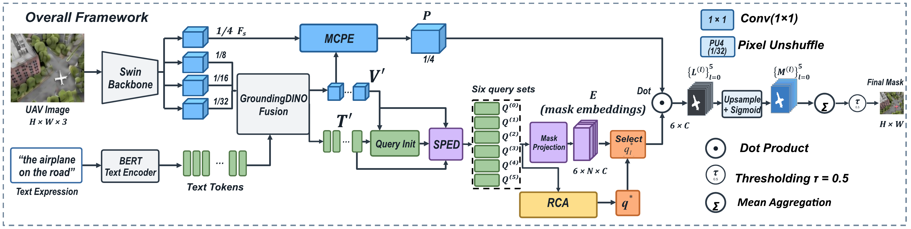

<div align="center">

# MRENet

### Low-Altitude UAV Referring Image Segmentation<br>via Multiscale Contextual Pixel Enhancement<br>and Referentially Guided Ensemble Prediction

**Shuo Zhang · Quanzhen Chen · Ming Li · Mengyu Song**<br>
**Haoyu Pan · Zhiyi Shi · Edmond Q. Wu**

**Multiscale context. Parallel decoding. Referential candidate selection.**


**[Prepare Data](#data-preparation) &nbsp;·&nbsp; [Getting Started](#getting-started)**

[Dataset](#dataset) &nbsp;·&nbsp; [Overview](#overview) &nbsp;·&nbsp; [Method](#method) &nbsp;·&nbsp; [Results](#results) &nbsp;·&nbsp; [Getting Started](#getting-started) &nbsp;·&nbsp; [Few-Shot Transfer](#few-shot-transfer) &nbsp;·&nbsp; [Code Guide](#code-guide)

</div>

---

## Dataset

**RIS-LAD** is the primary benchmark for low-altitude UAV referring image segmentation in this study. It covers eight object categories, including pedestrians, vehicles, and vessels. Each sample pairs an image with a natural-language expression and the mask of the referred target. Small objects, dense groups of similar instances, and complex backgrounds make precise segmentation challenging.

The manuscript uses the original RIS-LAD splits for training, model selection, and testing, and evaluates few-shot transfer on **RefSegRS** and **RRSIS-D**. Counts below are referring samples from Table 1.

| Dataset | Train | Validation | Test | Role |
| :--- | ---: | ---: | ---: | :--- |
| **RIS-LAD** | 9,712 | 1,396 | 2,763 | Source training and primary evaluation |
| **RefSegRS** | 2,172 | 431 | 1,817 | Few-shot adaptation and transfer evaluation |
| **RRSIS-D** | 12,181 | 1,740 | 3,481 | Few-shot adaptation and transfer evaluation |

Target-domain training counts describe the sampling pools. The main transfer experiments use **100 training annotations + 20 validation annotations per target domain**, with results averaged over three random seeds.

<details>
<summary><b>Data availability and valid samples</b></summary>

Obtain each dataset from its original provider, then follow [Prepare Data](#data-preparation). This repository does not redistribute dataset images or annotations.

The conversion described in the manuscript retains all RefSegRS samples. After removing RRSIS-D records with empty masks or inconsistent image/mask dimensions, the effective train, validation, and test counts are **12,170 / 1,738 / 3,477**. Record the effective sample counts when reporting results.

Dataset layouts and conversion details are documented in the [data conversion notes](docs/数据集格式转换说明_20261025.md).

</details>

## Overview

MRENet segments the target specified by a natural-language expression in low-altitude UAV imagery. It addresses two related challenges: **limited spatial detail in small targets** and **ambiguity among visually similar instances**.

Built on GroundingDINO, the framework uses **MCPE** to enhance pixel representations, **SPED** to produce multiple query sets, and **RCA** to assess referential relevance before mask aggregation.

<table align="center">
  <tr>
    <th align="center">48.85%</th>
    <th align="center">52.41%</th>
    <th align="center">+6.17 pp</th>
  </tr>
  <tr>
    <td align="center">RIS-LAD Test mIoU</td>
    <td align="center">RIS-LAD Test oIoU</td>
    <td align="center">mIoU gain over B0</td>
  </tr>
</table>

<p align="center"><sub>Results reported in the manuscript; not newly reproduced measurements from this code release.</sub></p>

## Method

MRENet connects **pixel enhancement**, **complementary candidate generation**, and **referential selection** in one segmentation pipeline.

<p align="center">
  <a href="assets/figures/figure1-overview.png">
    
  </a>
</p>
<p align="center"><sub><b>Figure 1.</b> Overall architecture of the proposed framework for low-altitude referring image segmentation. Original figure from the manuscript.</sub></p>

| Component | Role |
| :--- | :--- |
| **GroundingDINO · Swin-T + BERT** | Extract visual and text features, perform cross-modal interaction, and initialize language-conditioned queries and reference boxes. |
| **Multiscale Contextual Pixel Enhancement (MCPE)** | Re-encode three spatial paths, jointly model their context with SS2D, reinject context into aligned stage features, and fuse shallow spatial detail. |
| **Shared Parallel Ensemble Decoder (SPED)** | Reconnect six pretrained decoder layers as one shared layer and five independent branches, retaining all six candidate sets. |
| **Referential Consistency Assessment (RCA)** | Apply one shared scoring MLP and independently select the highest-scoring query within each candidate set. |
| **Auxiliary denoising (DN)** | Reconstruct targets from perturbed reference boxes during training, with branch-wise regeneration of the entire DN input set. |
| **Probability-mask fusion** | Restore each selected mask to the original image size, apply sigmoid, average the six probability masks, and threshold at `> 0.5`. |

<details>
<summary><b>How the six predictions are selected and fused</b></summary>

Each query set has its own selected index. RCA does not require the shared output and five parallel branches to select the same query index.

1. Score ordinary queries using the shared `Linear(D, D) → ReLU → Linear(D, 1)` head.
2. Select the highest-scoring query independently in each of the six sets.
3. Combine each selected mask embedding with the shared MCPE pixel features.
4. Restore logits to the padded canvas, remove padding, and resize to the original image dimensions.
5. Apply sigmoid to each restored mask, average probabilities with equal weights, and binarize.

During training, each ordinary output uses its own Hungarian assignment. That assignment supervises its token classification, boxes, masks, and RCA scores. DN queries use known target correspondences and are excluded from ordinary matching, RCA, and mask prediction. They are not generated at inference.

</details>

<details>
<summary><b>Implementation and reproduction status</b></summary>

- **Full-model configuration:** `configs/mrenet_rislad.py` enables MCPE, SPED, RCA, and DN, with 50 epochs, batch size 4, and no gradient accumulation.
- **Few-shot adaptation:** fixed three-seed sampling, nested annotation budgets, and the two-stage optimization protocol are available.
- **Selective scanning:** `rrs/selective_scan.py` provides an input-dependent, differentiable PyTorch implementation. It requires no separate selective-scan CUDA extension.
- **Validation:** 111 tests and an offline synthetic forward/backward/inference check passed on CPU. Full-size CUDA/AMP execution, complete training, runtime measurements, and manuscript benchmark reproduction remain to be evaluated.
- **Resources:** dataset files and trained task checkpoints are not included. The manuscript does not uniquely specify every scan-block parameter; implementation choices are recorded in the [implementation notes](docs/IMPLEMENTATION.md).

</details>

## Results

### RIS-LAD benchmark

**Test results from Table 2 of the manuscript.** Values are percentages; higher is better.

| Method | mIoU ↑ | oIoU ↑ |
| :--- | ---: | ---: |
| LAVT | 30.14 | 41.97 |
| ASDA | 33.33 | 37.53 |
| RMSIN | 39.60 | 48.82 |
| VATEX | 18.53 | 24.27 |
| LGCE | 26.17 | 40.75 |
| FIANet | 37.44 | 43.39 |
| RSRefSeg | 41.16 | 47.71 |
| CADFormer | 39.32 | 46.47 |
| SAARN | 41.67 | 49.60 |
| **MRENet (Ours)** | **48.85** | **52.41** |

<details>
<summary><b>Precision at different IoU thresholds</b></summary>

Prec@X for the full model, from Table 2. It measures the percentage of samples with mask `IoU >= X`; these IoU cutoffs differ from the probability threshold used for binarization.

| Prec@0.5 ↑ | Prec@0.6 ↑ | Prec@0.7 ↑ | Prec@0.8 ↑ | Prec@0.9 ↑ |
| ---: | ---: | ---: | ---: | ---: |
| 55.01 | 52.73 | 48.35 | 41.77 | 27.80 |

</details>

<details>
<summary><b>Module and denoising ablations</b></summary>

RIS-LAD test results from Table 4. B0 is the internal GroundingDINO-based baseline.

| Configuration | MCPE | SPED | RCA | Denoising | mIoU ↑ | oIoU ↑ |
| :--- | :---: | :---: | :---: | :--- | ---: | ---: |
| A · B0 | — | — | — | Disabled | 42.68 | 48.37 |
| B | ✓ | — | — | Disabled | 44.62 | 49.53 |
| C | — | ✓ | — | Disabled | 44.03 | 49.28 |
| D | ✓ | ✓ | — | Disabled | 45.86 | 50.26 |
| E | ✓ | ✓ | ✓ | Disabled | 47.58 | 51.54 |
| F | ✓ | ✓ | ✓ | Enabled, p = 0 | 48.32 | 52.01 |
| **G · Full model** | **✓** | **✓** | **✓** | **Enabled, p = 0.5** | **48.85** | 52.41 |
| H | ✓ | ✓ | ✓ | Enabled, p = 1 | 48.53 | **52.46** |

`p` is the probability of regenerating the entire DN input set for a parallel branch. DN supervision remains active at `p = 0`. The full model improves mIoU and oIoU over B0 by **6.17** and **4.04 percentage points**, respectively.

</details>

<details>
<summary><b>Few-shot transfer to remote sensing datasets</b></summary>

Manuscript results with 100 training and 20 separate validation annotations per target domain, averaged over three seeds.

| Target domain | Train / validation annotations | mIoU ↑ | oIoU ↑ |
| :--- | :---: | ---: | ---: |
| RefSegRS | 100 / 20 | 39.12 | 54.93 |
| RRSIS-D | 100 / 20 | 38.46 | 49.08 |

The two target domains are adapted independently from the RIS-LAD source model. Test sets are excluded from sampling, model selection, and threshold tuning. See [Few-Shot Transfer](#few-shot-transfer) for the implemented sampling and adaptation protocol.

</details>

## Getting Started

### 1. Installation

Run commands from the repository root. **Python 3.12** is recommended. Install a matching PyTorch/torchvision pair for your hardware, then install the remaining dependencies:

```bash
conda create -n mrenet python=3.12 -y
conda activate mrenet

# Example for a CUDA 12.8-compatible environment
python -m pip install torch==2.8.0 torchvision==0.23.0 --index-url https://download.pytorch.org/whl/cu128
python -m pip install -r requirements.txt
bash scripts/download_weights.sh
```

MCPE uses native PyTorch operations for selective scanning. On CUDA systems, the GroundingDINO deformable-attention extension can optionally be compiled for better performance:

```bash
bash scripts/build_groundingdino.sh
```

<details>
<summary><b>Environment versions, CPU execution, and pretrained resources</b></summary>

The manuscript reports Python 3.12.3, PyTorch 2.8.0, CUDA 12.8, cuDNN 9.10.2, and an NVIDIA RTX 3080 Ti. The recorded local checks used Python 3.12.14 and PyTorch 2.8.0+cpu. Choose your PyTorch build for the installed driver and hardware; the example above is not a claim that every GPU configuration has been validated.

For CPU-only checks, replace the PyTorch installation line with:

```bash
python -m pip install torch==2.8.0 torchvision==0.23.0 --index-url https://download.pytorch.org/whl/cpu
```

Without the GroundingDINO `_C` extension, the model uses its differentiable PyTorch deformable-attention implementation. CPU execution is useful for checks; full training is intended for a suitable GPU. The Bash setup and download scripts require a Bash shell.

Default pretrained-resource layout:

```text
weights/
├── groundingdino_swint_ogc.pth
└── bert-base-uncased/
    ├── config.json
    ├── vocab.txt
    ├── tokenizer_config.json
    ├── tokenizer.json
    └── model.safetensors
```

GroundingDINO weights initialize the model. Evaluation and prediction require a referring-segmentation checkpoint trained with the corresponding architecture.

</details>

<a name="data-preparation"></a>

### 2. Prepare data

Place the original datasets under `data/`, then generate unified JSONL annotations:

```bash
python tools/prepare_rislad.py --root data/RIS-LAD
python tools/prepare_remote_sensing.py --dataset refsegrs --data-root data
python tools/prepare_remote_sensing.py --dataset rrsisd --data-root data
```

RIS-LAD layout:

```text
data/RIS-LAD/
├── ris_lad/
│   ├── instances.json
│   └── refs(unc).p
├── images/ris_lad/
└── b0/                         # Generated annotations
    ├── train.jsonl
    ├── val.jsonl
    └── test.jsonl
```

See the [data conversion notes](docs/数据集格式转换说明_20261025.md) for RefSegRS and RRSIS-D layouts and validity checks.

<details>
<summary><b>Annotation format and other datasets</b></summary>

Each JSONL row represents one referring expression. `image` is relative to `image_root`; `bbox` uses COCO `xywh` coordinates in pixels; `segmentation` accepts COCO polygons or RLE.

```json
{"image":"images/example.jpg","caption":"the car on the left","height":512,"width":512,"id":"sample_1","objects":[{"bbox":[10,20,30,40],"segmentation":[[10,20,40,20,40,60,10,60]]}]}
```

The general dataset reader can also load empty or multiple-object samples. The full SPED/RCA inference path and the few-shot protocol described here target single-object referring segmentation.

RefCOCO parquet readers and RefDrone conversion tools remain available for separate experiments. Run `python tools/convert_refdrone.py --help` for options. Box-filled masks are for pipeline checks only.

</details>

### 3. Train

Train the complete model on RIS-LAD:

```bash
python tools/train.py --config configs/mrenet_rislad.py
```

| Setting | Full-model configuration |
| :--- | :--- |
| Input resizing | Shorter side 800; maximum longer side 1333; preserve aspect ratio |
| Augmentation | No random horizontal flipping |
| Optimizer | AdamW; weight decay `1e-4` |
| Learning rates | Visual backbone `1e-5`; other trainable modules `1e-4` |
| Text encoder | BERT frozen |
| Training schedule | 50 epochs; learning rate multiplied by 0.1 after epoch 30 |
| Batch size / accumulation | 4 / 1 |
| Training features | AMP, auxiliary mask losses, and DN enabled |
| Model selection | Validation mIoU |

Checkpoints and logs are saved to `work_dirs/mrenet_rislad/`.

<details>
<summary><b>Configurations, ablations, and compatibility names</b></summary>

| Configuration | Purpose | Entry point |
| :--- | :--- | :--- |
| [mrenet_rislad.py](configs/mrenet_rislad.py) | Full source-domain model | `tools/train.py` |
| [mrenet_refsegrs.py](configs/mrenet_refsegrs.py) | Few-shot transfer to RefSegRS | `tools/finetune.py` |
| [mrenet_rrsisd.py](configs/mrenet_rrsisd.py) | Few-shot transfer to RRSIS-D | `tools/finetune.py` |
| [b0_rislad.py](configs/b0_rislad.py) | Sequential-decoder FPN baseline | `tools/train.py` |

The main configuration uses `use_sped`, `use_mcpe`, `use_rca`, `mcpe`, and `sped_mask_mode`. Historical `use_hed`, `use_mmscope`, `use_ref_score`, `mm`, and `hed_mask_mode` names remain as compatibility aliases.

```bash
# Disable RCA: independently select each set by its maximum eligible-token probability
python tools/train.py --config configs/mrenet_rislad.py --opts use_rca=False

# Keep DN supervision but inherit all branch DN states from the shared layer
python tools/train.py --config configs/mrenet_rislad.py --opts dn.reinit_rate=0

# Reduce memory use; this changes the manuscript batch-size setting
python tools/train.py --config configs/mrenet_rislad.py --opts batch_size=1
```

RCA requires SPED. The historical `b0_*` configurations retain their original schedules and module defaults; they should not be treated as the full-model recipe.

Configurations support `_base_` inheritance. Dictionary fields are replaced as a whole; dotted `--opts` overrides change individual fields.

</details>

<details>
<summary><b>Resume training and initialize a different architecture</b></summary>

```bash
# Restore the same architecture, optimizer, scheduler, and epoch
python tools/train.py --config configs/mrenet_rislad.py --resume work_dirs/mrenet_rislad/last.pth --opts gdino_ckpt=None

# Initialize the full model from a compatible FPN baseline checkpoint
python tools/train.py --config configs/mrenet_rislad.py --init-from work_dirs/b0_rislad/best.pth --opts gdino_ckpt=None
```

`--resume` restores the saved model mode; explicit `--opts` values take precedence. `--init-from` loads compatible parameters into the architecture specified by the new configuration and reinitializes replaced modules. It does not restore the optimizer, epoch, or best score, and cannot be combined with `--resume` or `--eval-only`.

The current MCPE scan structure differs from the earlier pixel-decoder prototype. Old prototype checkpoints are not guaranteed to load into the new architecture.

</details>

### 4. Evaluate

Evaluate the selected checkpoint on the validation set:

```bash
python tools/train.py --config configs/mrenet_rislad.py --eval-only --resume work_dirs/mrenet_rislad/best.pth --opts gdino_ckpt=None
```

Use the test annotations only for final evaluation:

```bash
python tools/train.py --config configs/mrenet_rislad.py --eval-only --resume work_dirs/mrenet_rislad/best.pth --opts gdino_ckpt=None val_data.path=data/RIS-LAD/b0/test.jsonl output_dir=work_dirs/test_rislad
```

Metrics include mIoU, oIoU, and Prec@0.5/0.6/0.7/0.8/0.9. Mask binarization uses probability `> 0.5`; Prec@X measures the percentage of referring samples with mask `IoU >= X`.

### 5. Predict

```bash
python tools/infer.py --ckpt work_dirs/mrenet_rislad/best.pth --image example.jpg --text "the white car on the left" --out work_dirs/prediction.jpg
```

The command saves an overlay and a corresponding `_mask.png`. Model settings are restored from the checkpoint. Use `--sped-mask-mode avg` for six-mask fusion or `last` for the last-output ablation. Input resizing can be adjusted with `--short-side` and `--max-size`.

For the full model, the reported `queries` and `scores` contain six entries: one selected candidate per query set. They jointly produce a single target mask.

## Few-Shot Transfer

RefSegRS and RRSIS-D are adapted **independently** from the checkpoint selected on the RIS-LAD validation set.

### 1. Generate fixed annotation subsets

After converting and validating the target-domain annotations:

```bash
python tools/prepare_fewshot.py --root data/RefSegRS
python tools/prepare_fewshot.py --root data/RRSIS-D
```

For each seed in **0, 1, 2**, the sampler creates nested **20 / 100 / 200** training-annotation subsets and one shared **20-annotation validation set**. Each selected original image contributes one expression and its complete target mask. The test set remains separate.

### 2. Run progressive adaptation

```bash
python tools/finetune.py --config configs/mrenet_refsegrs.py --source-ckpt work_dirs/mrenet_rislad/best.pth --shots 100 --seed 0 --eval-test
python tools/finetune.py --config configs/mrenet_rrsisd.py --source-ckpt work_dirs/mrenet_rislad/best.pth --shots 100 --seed 0 --eval-test
```

Repeat with seeds 1 and 2 and report the mean. Use `--shots 20` or `--shots 200` for the other budgets. Every run starts independently from the same source-domain model.

| Setting | Stage 1 | Stage 2 |
| :--- | :--- | :--- |
| Visual backbone | Frozen | Trainable; learning rate `1e-6` |
| BERT | Frozen | Frozen |
| Task modules | Learning rate `1e-4` | Learning rate `1e-5` |
| Batch size / accumulation | 2 / 1 | 2 / 1 |
| AMP / DN | Enabled during training | Enabled during training |

<details>
<summary><b>Stage transitions, learning-rate adjustment, and model selection</b></summary>

- Evaluate every **50 successful parameter updates**.
- Switch to stage 2 after three consecutive evaluations without an improvement of at least **0.1 mIoU percentage points**, or after at most **300 updates** in stage 1.
- Reset the stagnation counters at the stage transition.
- In stage 2, multiply learning rates by **0.1** after each three-evaluation plateau; stop after six consecutive evaluations without the specified improvement.
- Limit both stages to **1,000 successful parameter updates** in total.
- Select `best.pth` by target-domain validation mIoU. `--eval-test` evaluates that selected checkpoint once after adaptation.

The protocol preserves source-domain resizing and mask restoration, with no random flipping, rotation, or image mixing. Split manifests record the selected annotation IDs and source-file hashes. The adaptation entry point checks that those source files are unchanged.

Target-domain configurations are intended for `tools/finetune.py`; ordinary epoch-based training rejects them to prevent accidental use of a different adaptation protocol.

</details>

## Code Guide

<details>
<summary><b>Repository structure</b></summary>

```text
MRENet/
├── configs/        Source training, target adaptation, and baseline settings
├── rrs/            Model components, losses, data, and postprocessing
├── tools/          Training, adaptation, prediction, conversion, and checks
├── scripts/        Environment setup, weight downloads, and optional builds
├── tests/          Unit and regression tests
├── docs/           Implementation, validation, and data-conversion notes
├── assets/         Manuscript framework figure and project badges
├── third_party/    GroundingDINO sources and retained licenses
├── requirements.txt
└── README.md
```

</details>

| Component | Implementation |
| :--- | :--- |
| Main architecture and checkpoint loading | [model.py](rrs/model.py) |
| MCPE pixel enhancement | [mcpe.py](rrs/mcpe.py) |
| Native PyTorch SS2D and scan block | [selective_scan.py](rrs/selective_scan.py) |
| SPED shared parallel decoder | [hed_decoder.py](rrs/hed_decoder.py) |
| RCA scoring head | [ref_score_head.py](rrs/ref_score_head.py) |
| Training-only denoising queries | [dn.py](rrs/dn.py) |
| Matching and training losses | [criterion.py](rrs/criterion.py) |
| Independent candidate selection, mask restoration, and metrics | [evaluate.py](rrs/evaluate.py) |
| Few-shot sampling and adaptation control | [adaptation.py](rrs/adaptation.py) |
| Dataset and preprocessing | [data.py](rrs/data.py) · [preprocess.py](rrs/preprocess.py) |
| Configuration and training utilities | [config.py](rrs/config.py) · [model_mode.py](rrs/model_mode.py) · [training.py](rrs/training.py) |
| Source-domain training and evaluation | [train.py](tools/train.py) |
| Target-domain sampling and fine-tuning | [prepare_fewshot.py](tools/prepare_fewshot.py) · [finetune.py](tools/finetune.py) |
| Single-image prediction | [infer.py](tools/infer.py) |

<details>
<summary><b>Development checks and validation scope</b></summary>

Run the unit and regression tests:

```bash
python -m unittest discover -s tests -v
```

Run the offline synthetic pipeline without downloading weights or datasets:

```bash
python tools/smoke_synthetic.py
```

The synthetic check uses a real Swin-T backbone, cross-modal interaction, and six decoder layers, with reduced BERT depth, encoder depth, query count, MCPE width, and input resolution. It checks training losses, gradient propagation, and inference with DN disabled.

The recorded CPU validation passed **111 tests with no failures, errors, or skipped cases**, plus the synthetic pipeline check. Tests compare the scan against a sequential recurrence, verify independent candidate selection and probability-fusion order, check DN isolation, and exercise the adaptation controller.

For a data- and weight-backed training smoke check:

```bash
python tools/smoke_mm_score.py --config configs/mrenet_rislad.py --iters 2
```

See the [validation record](docs/VALIDATION.md) and [structured results](docs/VALIDATION.json). These checks validate implementation behavior; they do not establish full training convergence, CUDA/AMP correctness, benchmark accuracy, or the manuscript's runtime measurements.

</details>

## Citation

Please cite the corresponding manuscript when using this work. Update the publication metadata once the paper is formally published.

```bibtex
@unpublished{zhang2026mrenet,
  title  = {Low-Altitude UAV Referring Image Segmentation via Multiscale
            Contextual Pixel Enhancement and Referentially Guided
            Ensemble Prediction},
  author = {Zhang, Shuo and Chen, Quanzhen and Li, Ming and Song, Mengyu and
            Pan, Haoyu and Shi, Zhiyi and Wu, Edmond Q.},
  year   = {2026},
  note   = {Manuscript}
}
```

## Acknowledgements and License

This project builds on [GroundingDINO](https://github.com/IDEA-Research/GroundingDINO), with Swin-T and BERT for visual and language encoding. Upstream copyright notices and licenses are retained in [third_party](third_party/README.md).

MCPE and the selective-scan implementation are included in this repository. See the [implementation notes](docs/IMPLEMENTATION.md) for the correspondence between the manuscript and the current code, including choices not fully specified by the manuscript. A top-level license for the original project code has not yet been specified.

<p align="center"><a href="#mrenet">Back to top ↑</a></p>
