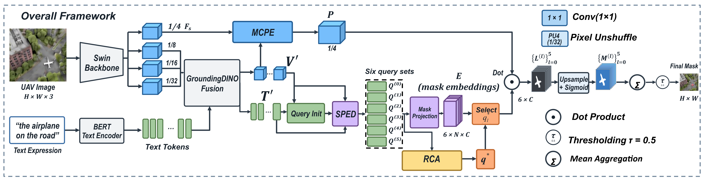

<div align="center">

# MRENet

### Low-Altitude UAV Referring Image Segmentation<br>via Multiscale Contextual Pixel Enhancement<br>and Referentially Guided Ensemble Prediction

**Shuo Zhang · Quanzhen Chen · Li Yu · Ming Li**<br>
**Haoyu Pan · Yilin Li · Zhiyi Shi · Edmond Q. Wu**

**多尺度上下文增强 · 共享并行解码 · 指代候选评分**


**[数据准备](#data-preparation) &nbsp;·&nbsp; [运行示例](#getting-started)**

[数据集](#dataset) &nbsp;·&nbsp; [概览](#overview) &nbsp;·&nbsp; [方法](#method) &nbsp;·&nbsp; [结果](#results) &nbsp;·&nbsp; [快速开始](#getting-started) &nbsp;·&nbsp; [代码导航](#code-guide)

</div>

---

<a name="dataset"></a>

## 数据集

**RIS-LAD** 是本研究的主要低空无人机指代分割基准，覆盖行人、车辆、船只等八类目标。每条样本包含图像、自然语言指代表达及目标掩码，场景中存在小目标、同类实例密集和复杂背景等挑战。

论文使用 RIS-LAD 的原始划分进行训练、模型选择与测试，并在 **RefSegRS** 和 **RRSIS-D** 上评估少样本迁移。下表数量均为指代样本数，来自论文 Table 1。

| 数据集 | 训练集 | 验证集 | 测试集 | 实验用途 |
| :--- | ---: | ---: | ---: | :--- |
| **RIS-LAD** | 9,712 | 1,396 | 2,763 | 源域训练、模型选择与主实验 |
| **RefSegRS** | 2,172 | 431 | 1,817 | 少样本适配与迁移评估 |
| **RRSIS-D** | 12,181 | 1,740 | 3,481 | 少样本适配与迁移评估 |

遥感数据集的训练集数量表示抽样池大小。论文主要迁移实验使用每个目标域 **100 条训练标注 + 20 条验证标注**，并报告三个随机种子的平均结果。

<details>
<summary><b>数据有效性与获取说明</b></summary>

数据集由各自发布方提供，本仓库不包含原始图像、标注或重新分发的数据压缩包。获取数据后，请按下方[数据准备](#data-preparation)说明转换。

论文报告的转换流程保留全部 RefSegRS 样本；RRSIS-D 排除空掩码及图像/掩码尺寸不一致的记录后，有效训练、验证、测试样本数分别为 **12,170 / 1,738 / 3,477**。少样本抽样与测试应使用有效子集，并记录实际样本数。

数据目录、字段和异常记录处理见[数据转换说明](docs/数据集格式转换说明_20261025.md)。

</details>

<a name="overview"></a>

## 概览

MRENet 根据自然语言描述，在低空无人机图像中分割出被指代的目标。方法关注两个相互关联的问题：**小目标的像素与边界信息不足**，以及**密集场景中相似实例难以区分**。

模型以 GroundingDINO 为基础，通过 **MCPE** 增强多尺度像素表征，通过 **SPED** 生成多组查询预测，再使用 **RCA** 评估候选与指代表达的相关性，并融合输出掩码。

<table align="center">
  <tr>
    <th align="center">48.85%</th>
    <th align="center">52.41%</th>
    <th align="center">+6.17 个百分点</th>
  </tr>
  <tr>
    <td align="center">RIS-LAD Test mIoU</td>
    <td align="center">RIS-LAD Test oIoU</td>
    <td align="center">相较 B0 的 mIoU 提升</td>
  </tr>
</table>

<p align="center"><sub>数值来自论文 Table 2 与 Table 4，为论文报告结果，未经本次代码整理重新训练复现。</sub></p>

<a name="method"></a>

## 方法

<p align="center">
  <a href="assets/figures/figure1-overview.png">
    
  </a>
</p>

<p align="center"><sub><b>图 1 · 整体框架。</b>点击图片查看高清原图，或打开 <a href="assets/figures/figure1-overview.pdf">矢量 PDF</a> 放大查看。</sub></p>

| 组件 | 作用 |
| :--- | :--- |
| **GroundingDINO · Swin-T + BERT** | 提取视觉与文本特征，构建跨模态查询与目标定位基础。 |
| **Multiscale Contextual Pixel Enhancement（MCPE）** | 通过多尺度上下文重编码与浅层细节融合，增强用于掩码预测的像素表征。 |
| **Shared Parallel Ensemble Decoder（SPED）** | 使用一个共享层与五个独立参数的并行层，生成六组查询输出。 |
| **Referential Candidate Assessment（RCA）** | 对候选进行指代相关性评分，为目标选择提供依据。 |
| **辅助去噪训练（DN）** | 利用扰动查询提供辅助监督，支持并行分支去噪输入的随机重采样。 |
| **概率掩码集成** | 将选中掩码恢复至原图尺寸后融合，输出最终二值分割结果。 |

现有代码目录沿用 **B0_HED**，其中 `MMSCopE`、`HED`、`RefScoreHead` 分别对应上述像素增强、解码和候选评分部分。源码位置见[代码导航](#code-guide)。

<details>
<summary><b>论文与当前代码的对应说明</b></summary>

当前发布内容是保留既有运行行为的代码整理版，尚未完成全部论文实验的实现对齐与独立复现。

- **候选选择：** 论文描述每层独立选择最高分候选后融合；当前 `rrs/evaluate.py` 先平均六层候选分数，再选择六层共用的候选索引。两者的对应关系仍需结合实验记录核对。
- **训练配方：** 论文主实验为 50 epochs、batch 4、无梯度累积并启用 DN；现有完整组合配置默认 12 epochs、batch 2、累积 2 且关闭 DN。下方命令运行的是现有配置。
- **少样本迁移：** 当前遥感配置支持数据读取与常规训练，尚未包含论文完整的三种子、嵌套预算和两阶段训练流程。
- **验证范围：** 单元测试用于检查代码行为；完整训练、真实 SS2D CUDA 算子和论文指标需在相应 GPU 环境中另行验证。本仓库未附论文训练权重。

</details>

<a name="results"></a>

## 结果

### RIS-LAD 主实验

以下为论文 **Table 2** 的测试集结果，单位为百分比，数值越高越好。

| 方法 | mIoU ↑ | oIoU ↑ |
| :--- | ---: | ---: |
| LAVT | 30.14 | 41.97 |
| ASDA | 33.33 | 37.53 |
| RMSIN | 39.60 | 48.82 |
| VATEX | 18.53 | 24.27 |
| LGCE | 26.17 | 40.75 |
| FIANet | 37.44 | 43.39 |
| RSRefSeg | 41.16 | 47.71 |
| CADFormer | 39.32 | 46.47 |
| SAARN | 41.67 | 49.60 |
| **MRENet（Ours）** | **48.85** | **52.41** |

<details>
<summary><b>不同 IoU 阈值下的指代分割精度</b></summary>

论文 Table 2 中完整方法的 Prec@X。该指标统计预测掩码满足 `IoU >= X` 的样本比例，与掩码二值化的概率阈值不同。

| Prec@0.5 ↑ | Prec@0.6 ↑ | Prec@0.7 ↑ | Prec@0.8 ↑ | Prec@0.9 ↑ |
| ---: | ---: | ---: | ---: | ---: |
| 55.01 | 52.73 | 48.35 | 41.77 | 27.80 |

</details>

<details>
<summary><b>模块与去噪策略消融</b></summary>

论文 Table 4 的 RIS-LAD 测试集结果。B0 为基于 GroundingDINO 的内部基线。

| 配置 | MCPE | SPED | RCA | DN 策略 | mIoU ↑ | oIoU ↑ |
| :--- | :---: | :---: | :---: | :--- | ---: | ---: |
| A · B0 | — | — | — | 关闭 | 42.68 | 48.37 |
| B | ✓ | — | — | 关闭 | 44.62 | 49.53 |
| C | — | ✓ | — | 关闭 | 44.03 | 49.28 |
| D | ✓ | ✓ | — | 关闭 | 45.86 | 50.26 |
| E | ✓ | ✓ | ✓ | 关闭 | 47.58 | 51.54 |
| F | ✓ | ✓ | ✓ | 开启，p = 0 | 48.32 | 52.01 |
| **G · 完整方法** | **✓** | **✓** | **✓** | **开启，p = 0.5** | **48.85** | 52.41 |
| H | ✓ | ✓ | ✓ | 开启，p = 1 | 48.53 | **52.46** |

`p` 表示并行分支重新生成整组 DN 输入的概率。`p = 0` 时仍保留 DN 监督，不等于关闭 DN。完整方法相较 B0 提升 **6.17 个百分点 mIoU** 和 **4.04 个百分点 oIoU**。

</details>

<details>
<summary><b>遥感数据集上的少样本迁移</b></summary>

论文报告的主要迁移设置：各目标域使用 100 条训练标注和另取的 20 条验证标注，报告三个随机种子的测试均值。

| 目标域 | 训练 / 验证标注 | mIoU ↑ | oIoU ↑ |
| :--- | :---: | ---: | ---: |
| RefSegRS | 100 / 20 | 39.12 | 54.93 |
| RRSIS-D | 100 / 20 | 38.46 | 49.08 |

两个目标域分别从 RIS-LAD 源模型进行适配，测试集不参与抽样、选模或阈值调整。当前代码的完整协议支持状态见上方“论文与当前代码的对应说明”。

</details>

<a name="getting-started"></a>

## 快速开始

### 1. 安装环境

以下命令在仓库根目录执行。完整像素增强模块需要 **Linux、NVIDIA GPU、Triton 和真实 selective scan CUDA 算子**。

```bash
conda create -n mrenet python=3.10 -y
conda activate mrenet
python -m pip install torch==2.4.1 torchvision==0.19.1 --index-url https://download.pytorch.org/whl/cu121
python -m pip install -r requirements.txt
bash scripts/build_groundingdino.sh
bash scripts/download_weights.sh
```

启用 `use_mmscope=True` 时，还需安装并检查 SS2D：

```bash
bash scripts/setup_mmscope.sh
python tools/check_ss2d.py
```

<details>
<summary><b>环境版本、服务器安装与预训练权重</b></summary>

上述命令沿用当前代码的安装示例，不代表全部 CUDA/显卡组合已经验证。论文报告的环境为 Python 3.12.3、PyTorch 2.8.0、CUDA 12.8、cuDNN 9.10.2 和 RTX 3080 Ti；复现实验时应记录实际环境。

其他安装入口：

```bash
bash scripts/setup_server.sh
# 使用已有环境
bash scripts/setup_server.sh --existing-env
# AutoDL 环境
bash scripts/setup_autodl.sh
```

可通过 `HF_ENDPOINT`、`CUDA_HOME`、`TORCH_CUDA_ARCH_LIST` 调整下载源与编译设置。默认 PyTorch 2.4.1 安装脚本支持 `cu118`、`cu121`、`cu124`。CUDA 扩展编译需要对应的 CUDA toolkit 和 `nvcc`。

预训练资源默认放置为：

```text
weights/
├── groundingdino_swint_ogc.pth
└── bert-base-uncased/
    ├── config.json
    ├── vocab.txt
    ├── tokenizer_config.json
    ├── tokenizer.json
    └── model.safetensors
```

GroundingDINO 官方权重用于初始化，不能代替本任务训练后的分割 checkpoint。下方评估和预测命令需要先完成相应训练。

未编译 GroundingDINO `_C` 时，B0/HED 可使用原有的 PyTorch 注意力路径，但速度可能较慢。完整 MMSCopE 的 SS2D 仍需真实 CUDA 实现，CPU 测试不能代替该检查。

</details>

<a name="data-preparation"></a>

### 2. 准备数据

将原始数据放入 `data/`，再生成统一 JSONL 标注：

```bash
python tools/prepare_rislad.py --root data/RIS-LAD
python tools/prepare_remote_sensing.py --dataset refsegrs --data-root data
python tools/prepare_remote_sensing.py --dataset rrsisd --data-root data
```

RIS-LAD 的目录布局：

```text
data/RIS-LAD/
├── ris_lad/
│   ├── instances.json
│   └── refs(unc).p
├── images/ris_lad/
└── b0/                         # 转换后生成
    ├── train.jsonl
    ├── val.jsonl
    └── test.jsonl
```

RefSegRS / RRSIS-D 的目录与转换规则见[数据转换说明](docs/数据集格式转换说明_20261025.md)。

<details>
<summary><b>通用标注格式与其他数据集</b></summary>

每行 JSONL 对应一条指代表达。`image` 相对于配置的 `image_root`；`bbox` 使用像素单位的 COCO `xywh`；`segmentation` 支持 COCO polygon 或 RLE。

```json
{"image":"images/example.jpg","caption":"the car on the left","height":512,"width":512,"id":"sample_1","objects":[{"bbox":[10,20,30,40],"segmentation":[[10,20,40,20,40,60,10,60]]}]}
```

`objects` 可以为空或包含多个目标。RefCOCO 支持 `jxu124/refcoco` 的 parquet 标注；RefDrone 转换选项可通过 `python tools/convert_refdrone.py --help` 查看。框填充掩码仅供流程检查，不能替代真实分割标注。

</details>

### 3. 训练

运行现有 HED 配置：

```bash
python tools/train.py --config configs/b0_hed_rislad.py
```

运行 HED + MMSCopE + 评分头，并显式启用 DN：

```bash
python tools/train.py --config configs/b0_hed_mm_score_rislad.py --opts use_dn=True
```

以上命令使用现有训练配方，具体区别见“论文与当前代码的对应说明”。日志与 checkpoint 写入配置的 `output_dir`，最佳模型按验证集 mIoU 选择。

<details>
<summary><b>模型组合与配置继承</b></summary>

| 代码模式 | RIS-LAD 配置 | 说明 |
| :--- | :--- | :--- |
| B0 | [b0_rislad.py](configs/b0_rislad.py) | 基础模型 |
| HED | [b0_hed_rislad.py](configs/b0_hed_rislad.py) | 共享并行解码 |
| HED + DN | [b0_hed_dn_rislad.py](configs/b0_hed_dn_rislad.py) | DN 仅用于训练 |
| HED + MMSCopE | [b0_hed_mm_rislad.py](configs/b0_hed_mm_rislad.py) | 需要真实 SS2D |
| HED + Score | [b0_hed_score_rislad.py](configs/b0_hed_score_rislad.py) | 指代评分头 |
| HED + MMSCopE + Score | [b0_hed_mm_score_rislad.py](configs/b0_hed_mm_score_rislad.py) | 默认关闭 DN，可显式开启 |

配置通过 `_base_ = "base.py"` 继承，由 `rrs.config.load_cfg()` 加载。字典字段整体替换；局部修改可使用 `dict(train_data, max_samples=16)` 或命令行点号参数。

现有 RIS-LAD B0 默认 `batch_size=1, grad_accum=1`，HED 默认 `batch_size=2, grad_accum=2`。进行对比实验时需统一实际训练设置，并记录物理 batch 与梯度累积；相同的有效 batch 不一定保证 padding 与数值行为一致。

</details>

<details>
<summary><b>恢复训练与跨架构初始化</b></summary>

```bash
# 同架构恢复模型、优化器、调度器与轮数
python tools/train.py --config configs/b0_hed_rislad.py --resume work_dirs/b0_hed_rislad_noDN/last.pth --opts gdino_ckpt=None

# 使用兼容参数初始化新组合，新增模块重新初始化
python tools/train.py --config configs/b0_hed_mm_score_rislad.py --init-from work_dirs/b0_hed_rislad_noDN/best.pth --opts gdino_ckpt=None
```

`--resume` 从 checkpoint 恢复模型模式，显式 `--opts` 优先；`--init-from` 使用当前配置的模型模式，与 `--resume`、`--eval-only` 互斥。当前恢复机制不承诺与不中断训练逐位一致。

</details>

### 4. 评估

验证集评估：

```bash
python tools/train.py --config configs/b0_hed_rislad.py --eval-only --resume work_dirs/b0_hed_rislad_noDN/best.pth --opts gdino_ckpt=None
```

最终测试时显式指定 test 标注，训练期间仍使用验证集选模：

```bash
python tools/train.py --config configs/b0_hed_rislad.py --eval-only --resume work_dirs/b0_hed_rislad_noDN/best.pth --opts gdino_ckpt=None val_data.path=data/RIS-LAD/b0/test.jsonl output_dir=work_dirs/test_rislad
```

评估包含 mIoU、oIoU 和 Prec@0.5/0.6/0.7/0.8/0.9。掩码恢复至原图尺寸后，以概率 `> 0.5` 二值化；Prec@X 使用 `IoU >= X`。

### 5. 单图预测

```bash
python tools/infer.py --ckpt work_dirs/b0_hed_rislad_noDN/best.pth --image example.jpg --text "the white car on the left" --out work_dirs/prediction.jpg
```

程序保存叠加图与同名 `_mask.png` 二值掩码。模型模式从 checkpoint 配置恢复；`--hed-mask-mode avg` / `last` 控制掩码汇总方式。默认输入短边为 800、长边不超过 1333，可用 `--short-side` 和 `--max-size` 调整。

<a name="code-guide"></a>

## 代码导航

<details>
<summary><b>仓库目录</b></summary>

```text
B0_HED/
├── configs/        数据集、模型组合与诊断配置
├── rrs/            模型、训练公共逻辑、数据、损失与后处理
├── tools/          训练、评估、推理、数据转换与运行检查
├── scripts/        环境安装、权重下载与 CUDA 编译
├── tests/          CPU 单元测试
├── docs/           模块接入与数据说明
├── assets/         整体框架图、矢量 PDF 与主页徽章
├── third_party/    必需的第三方源码、版本与许可证
├── .github/        自动检查工作流
├── requirements.txt
└── README.md
```

</details>

| 内容 | 实现 |
| :--- | :--- |
| 总体模型与权重加载 | [model.py](rrs/model.py) |
| MCPE 对应的像素增强实现 | [mmscope_pixel_decoder.py](rrs/mmscope_pixel_decoder.py) |
| SPED 对应的共享并行解码 | [hed_decoder.py](rrs/hed_decoder.py) |
| RCA 候选评分头 | [ref_score_head.py](rrs/ref_score_head.py) |
| 去噪查询与分支采样 | [dn.py](rrs/dn.py) |
| 匹配与训练损失 | [criterion.py](rrs/criterion.py) |
| 候选选择、掩码恢复与指标 | [evaluate.py](rrs/evaluate.py) |
| 数据读取与预处理 | [data.py](rrs/data.py) · [preprocess.py](rrs/preprocess.py) |
| 配置与训练公共工具 | [config.py](rrs/config.py) · [training.py](rrs/training.py) |
| 训练 / 评估入口 | [train.py](tools/train.py) |
| 单图推理入口 | [infer.py](tools/infer.py) |

<details>
<summary><b>开发检查与 GPU 验证</b></summary>

CPU 单元测试与语法检查：

```bash
python -m unittest discover -s tests -v
python -m compileall -q rrs tools configs tests
```

测试不需要下载预训练权重；MMSCopE 的形状与接线测试使用桩，不验证真实 CUDA 扫描内核。[GitHub Actions 工作流](.github/workflows/tests.yml)执行 CPU 测试与语法检查。

准备数据、权重和 GPU 环境后，可运行：

```bash
python tools/check_b0.py --config configs/b0_refcoco.py
python tools/smoke_dn.py --config configs/b0_hed_dn_rislad.py --iters 2
python tools/smoke_mm_score.py --config configs/b0_hed_mm_score_rislad.py --iters 2
bash scripts/verify_mm_score.sh
```

这些运行检查用于验证流程，不代替完整训练和性能评估。

</details>

## 引用

使用本研究时，请引用对应论文。以下按当前稿件信息列出，正式发表后应更新出版信息。

```bibtex
@unpublished{zhang2026mrenet,
  title  = {Low-Altitude UAV Referring Image Segmentation via Multiscale
            Contextual Pixel Enhancement and Referentially Guided
            Ensemble Prediction},
  author = {Zhang, Shuo and Chen, Quanzhen and Yu, Li and Li, Ming and
            Pan, Haoyu and Li, Yilin and Shi, Zhiyi and Wu, Edmond Q.},
  year   = {2026},
  note   = {Manuscript}
}
```

## 致谢与许可

本项目基于 [GroundingDINO](https://github.com/IDEA-Research/GroundingDINO) 构建，并使用或参考 SegMAN / MMSCopE、Open-GroundingDino 与 FT-FSOD 的相关实现。来源、固定版本和保留内容见[第三方说明](third_party/README.md)。

模块适配细节见 [HED + DN 接入说明](docs/HED_DN接入说明_20261013.md)和 [MMSCopE 与评分头说明](docs/MMSCopE与评分头接入说明_20261016.md)。第三方代码保留各自版权声明与许可证；本项目原创部分尚未指定统一开源许可证。

<p align="center"><a href="#mrenet">返回顶部 ↑</a></p>
